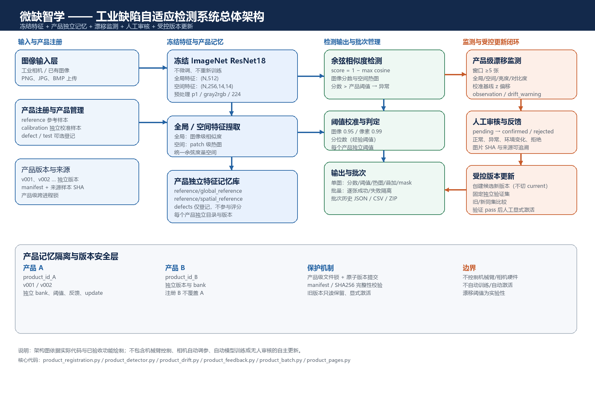
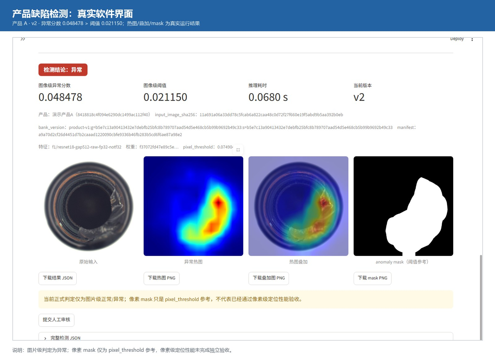
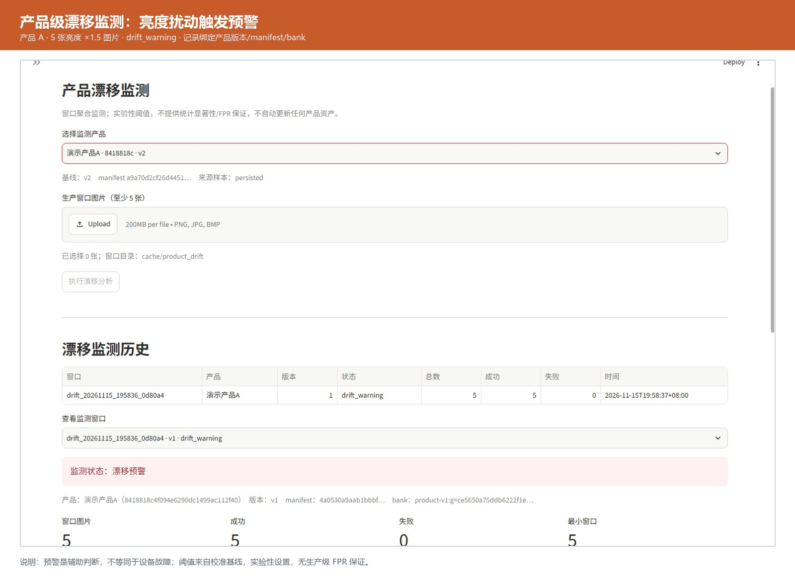
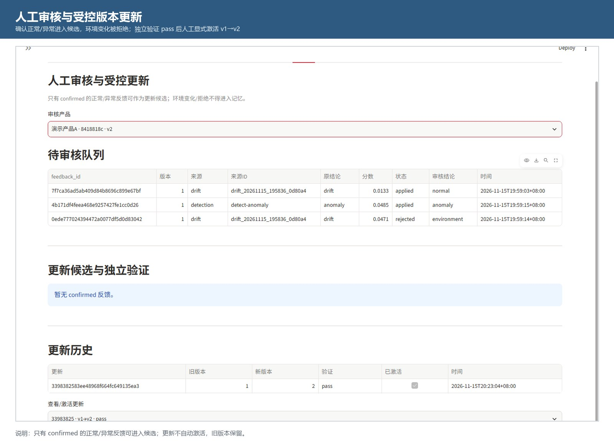
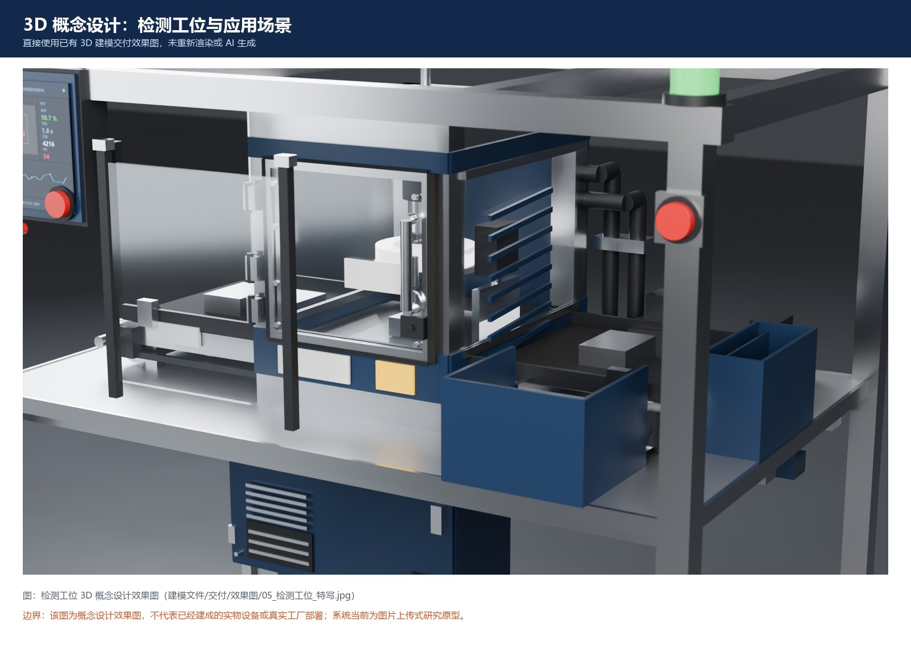

<div align="center">

# MicroDefect

**Adaptive visual defect detection for multi-product manufacturing**

[English](README.md) | [简体中文](README.zh-CN.md)


</div>

> [!WARNING]
> This is a research prototype, not a production inspection system. It does not control robots or cameras and does not provide production-level false-positive guarantees.

## Overview

MicroDefect is a product-centric visual anomaly detection prototype for multi-product, low-volume manufacturing.

Instead of training one model per product, it builds a **product-specific feature memory** from a small set of normal images, scores new images against that memory, monitors distribution drift, and supports human-reviewed version updates.

The goal is not a generic defect classifier. The goal is a **manageable inspection memory** that can be registered, monitored, reviewed, versioned, and validated.

## Why

- **Frequent product changeovers** make per-product training and tuning expensive.
- **New products rarely have enough defect samples** for supervised classification.
- **Lighting, camera position, and batch changes** can invalidate fixed thresholds.
- **Human feedback** is often recorded informally, without a verifiable update path.
- **Shared models** can interfere across products; one product's update may degrade another.

## Features

| Feature | Description |
|---|---|
| Few-shot product registration | Normal references + independent calibration images build a product-specific bank and threshold |
| Single-image inspection | Image score, threshold, normal/anomaly, heatmap, overlay, mask, JSON |
| Batch inspection | Per-image isolation, failures, stop/resume semantics, batch history, CSV/JSON/ZIP |
| Drift monitoring | Global/spatial distance, brightness, contrast, `observation` / `drift_warning` |
| Human review | Confirm normal, confirm anomaly, environment change, reject; auditable states |
| Controlled updates | Candidate version stays non-current; old and new versions are compared |
| Independent validation | Fixed validation set; explicit human activation; failed updates keep the old current |
| Multi-product isolation | Separate product ID, version, memory bank, threshold, feedback, and update records |

## How it works

```text
image
  │
  ├─ frozen ResNet18 features (global 512 / spatial 256×14×14)
  │
  ├─ product-specific reference bank
  │
  ├─ cosine distance: 1 − max cosine
  │
  ├─ product threshold → normal / anomaly
  │
  ├─ single / batch / batch history
  │
  └─ window statistics → drift warning
        │
        └─ human review
              │
              └─ candidate version
                    │
                    └─ fixed validation set
                          │
                          ├─ pass → human activation (old version retained)
                          └─ fail / inconclusive → keep current version
```

Design principles:

- **Frozen backbone** — no fine-tuning on industrial data; lower data and compute requirements.
- **Product-specific memory** — products do not share banks or thresholds.
- **Warnings are not diagnoses** — drift suggests checking light, camera, angle, batch, and environment.
- **Updates are not automatic** — human review, independent validation, and explicit activation are required.

<p align="center">
  
</p>

## Screenshots

| Inspection | Drift monitoring |
|---|---|
|  |  |

| Review and controlled update | 3D concept |
|---|---|
|  |  |

The 3D image is an existing concept-design render, not a photo of deployed equipment.

## Quick start

### Requirements

- Python 3.12
- Windows 10/11 (validated environment)
- Streamlit, PyTorch, torchvision, NumPy, Pillow, pandas, OpenCV, Matplotlib

### Install

```bash
git clone https://github.com/cfxgy/microdefect.git
cd microdefect

python -m venv .venv
# Windows
.venv\Scripts\activate
# Linux / macOS
source .venv/bin/activate

pip install -r requirements.txt
```

### Model weights

Weights are **not included** and are not downloaded automatically.

```text
file:    resnet18-f37072fd.pth
sha256:  f37072fd47e89c5e827621c5baffa750081f7896bbacec160b1a16c560e07ec
```

Place the file at:

```text
cache/torch/hub/checkpoints/resnet18-f37072fd.pth
```

or:

```text
~/.cache/torch/hub/checkpoints/resnet18-f37072fd.pth
```

Obtain it from a trusted source and comply with its license. Do not substitute randomly initialized weights.

### Data

Datasets are **not included**. Use data you are authorized to use.

```text
datasets/
  your_product/
    reference/      # at least 5 normal images
    calibration/    # 20–25 independent normal images
    test_normal/
    test_defect/
```


### Run

```bash
streamlit run src/ui/app.py
```

Open `http://127.0.0.1:8501`.

Windows:

```bat
scripts\run_app.bat
```

### Test

```bash
python -m unittest discover -s tests -p "test_*.py"
```

Some tests require local weights or datasets; without them, related tests may skip or fail.

## Results

### MVTec AD official split

15 categories × 5 seeds × 5-shot, offline:

| Metric | Macro mean |
|---|---:|
| Image AUROC | **0.8494** |
| Image AP | **0.9401** |
| Image F1 | **0.7605** |
| Pixel AUROC | **0.9235** |
| Pixel AP | **0.3825** |

### Group-disjoint split (4 classes)

bottle / pill / toothbrush / zipper, single seed:

| Metric | Macro mean |
|---|---:|
| Image AUROC | **0.8460** |
| Image AP | **0.9132** |
| Image F1 | **0.6517** |
| Pixel AUROC | **0.9623** |
| Pixel AP | **0.4446** |

> [!NOTE]
> The Group-disjoint result covers only four classes and one seed. It is not comparable to the official split and should not be generalized to all categories.

### Product-level demo

| Scenario | Result |
|---|---|
| Normal image, product A | score `0.012513`, threshold `0.021150` |
| Anomalous image, product A | score `0.048478`, threshold `0.021150` |
| Batch | 7 images → 5 succeeded / 2 failed, `partial` |
| Brightness shift | ×1.5 → `drift_warning` |
| Controlled update | v1 → v2, independent validation 5+5, `pass` |
| Multi-product | A/B isolated; 173 files of A unchanged after control registration |
| Automated tests | 504 run / 503 passed / 1 skipped / 0 failed |

All results depend on data split, thresholds, and sample size. They are **not** production performance guarantees. See [docs/EXPERIMENTS.md](docs/EXPERIMENTS.md).

## Repository layout

```text
src/
  core/           product/version/registration/inspection/batch/drift/feedback/update
  anomaly/        cosine scoring
  features/       frozen feature extraction
  ui/             Streamlit pages and services
tests/            automated tests
scripts/          run/register/inspect helpers
docs/             architecture, experiments, operations, limitations, images
requirements.txt
LICENSE           Apache-2.0
NOTICE
```

## Limitations

- Image-upload workflow, not continuous in-line inspection.
- No real factory deployment or long-term production data.
- No robot control; no automatic camera adjustment.
- No PLC / MES / QMS integration.
- Drift thresholds are experimental; no production FPR guarantee.
- Product-level validation is limited; more categories, batches, and field samples are needed.
- NEU-CLS data has only been audited; no classification accuracy is reported.
- Pixel-level localization has not been independently accepted; masks are threshold references.

## Documentation

| Document | Content |
|---|---|
| [Architecture](docs/ARCHITECTURE.md) | Layers, modules, data flow, storage |
| [Experiments](docs/EXPERIMENTS.md) | Datasets, metrics, protocols, limitations |
| [Operations](docs/OPERATIONS.md) | Install, register, inspect, drift, review, update |
| [Limitations](docs/LIMITATIONS.md) | What this project does not claim |
| [Images](docs/IMAGES.md) | Screenshot and 3D image sources |

The detailed docs are currently written in Chinese.

## Roadmap

- [ ] Real camera/lighting integration and capture triggering
- [ ] Single-station pilot with independent field samples
- [ ] More product categories and batch-level validation
- [ ] PLC / MES / QMS adapters
- [ ] Edge-device performance and long-run stability tests
- [ ] Stronger report integrity and deployment operations

## Contributing

Issues and pull requests are welcome. Please keep changes focused and include tests where practical.

For bug reports, include:

- operating system and Python version
- command used
- expected vs. actual behavior
- minimal sample or error trace (remove sensitive data)

## License

Code is released under the [Apache License 2.0](LICENSE).

Datasets, pretrained weights, and 3D renders are **not** covered by this repository's license. See [NOTICE](NOTICE) and confirm the original licenses before use.

## Acknowledgement

This project builds on PyTorch, torchvision, Streamlit, MVTec AD, and NEU-CLS. Dataset and model-weight licenses remain with their respective owners.
