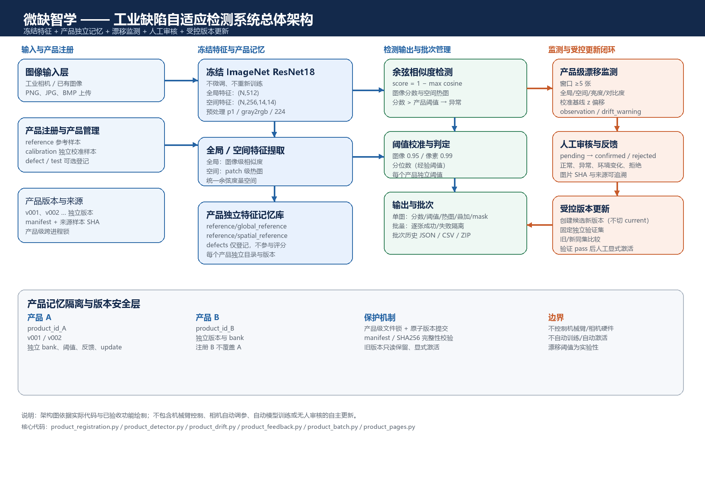

<div align="center">

# MicroDefect / 微缺智学

**面向多品种制造的工业视觉缺陷自适应检测原型**

[English](README.md) | [简体中文](README.zh-CN.md)


</div>

> [!WARNING]
> 本项目是研究原型，不是量产工业设备；不控制机械臂或相机，也不提供生产级误报率保证。

## 简介

MicroDefect 面向多品种、小批量生产场景：用少量正常样本为每个产品建立独立特征记忆，判断新图片是否偏离正常，并支持漂移监测、人工审核和受控版本更新。

它不是“一个模型打天下”的缺陷分类器，而是把检测策略做成可注册、可监测、可追溯、可验证的产品级资产。

## 解决什么问题

- 换产频繁，逐产品训练/调参成本高；
- 新产品缺陷样本少，难以做监督分类；
- 光照、相机位置、角度和批次变化会让固定阈值失准；
- 人工反馈缺少可验证的更新流程；
- 多产品共用一个模型容易互相干扰。

## 功能

| 功能 | 说明 |
|---|---|
| 少样本产品注册 | 正常参考 + 独立校准，建立产品自己的记忆和阈值 |
| 单图检测 | 分数、阈值、正常/异常、热图、叠加、mask、JSON |
| 批量检测 | 逐张隔离失败、批次历史、CSV/JSON/ZIP |
| 漂移监测 | 全局/空间距离、亮度、对比度，observation/drift_warning |
| 人工审核 | 确认正常/异常、环境变化、拒绝，状态可追溯 |
| 受控更新 | 候选版本不切 current，固定验证集比较旧/新版本 |
| 独立验证与激活 | pass 后人工点击；失败保留旧版本 |
| 多产品隔离 | 独立 product_id、版本、bank、阈值、反馈和更新目录 |

## 工作流程

```text
图片
  → 冻结 ResNet18 特征
  → 产品独立 reference bank
  → 余弦距离 1 − max cosine
  → 产品阈值判断
  → 单图 / 批量 / 历史
  → 窗口漂移监测
  → 人工审核
  → 候选版本
  → 固定验证集
  → 人工激活（旧版本保留）
```

<p align="center">
  
</p>

## 快速开始

```bash
git clone https://github.com/cfxgy/microdefect.git
cd microdefect

python -m venv .venv
# Windows
.venv\Scripts\activate
# Linux / macOS
source .venv/bin/activate

pip install -r requirements.txt
streamlit run src/ui/app.py
```

浏览器打开 `http://127.0.0.1:8501`。

### 模型权重

仓库不包含权重，也不会自动下载。

```text
resnet18-f37072fd.pth
sha256: f37072fd47e89c5e827621c5baffa750081f7896bbacec160b1a16c560e07ec
```

放到：

```text
cache/torch/hub/checkpoints/resnet18-f37072fd.pth
```

### 数据

仓库不包含数据集。按产品准备至少 5 张正常参考图、20–25 张独立校准图；`datasets/` 已被 Git 忽略。

### 测试

```bash
python -m unittest discover -s tests -p "test_*.py"
```

部分测试需要本地权重/数据。

## 已验证结果

| 实验 | 结果 |
|---|---|
| MVTec AD 官方划分，5-shot | Image AUROC 0.8494 / AP 0.9401 / F1 0.7605 |
| Group-disjoint，4 类 | Image AUROC 0.8460 / AP 0.9132 / F1 0.6517 |
| 产品级正常/异常 | 0.012513 / 0.048478，阈值 0.021150 |
| 批量 | 7 图 → 5 成功 / 2 失败，partial |
| 亮度漂移 | ×1.5 → drift_warning |
| 受控更新 | v1 → v2，独立验证 5+5，pass |
| 自动化测试 | 504 项 / 503 通过 / 1 跳过 / 0 失败 |

Group-disjoint 仅 4 类、单 seed，不能外推到所有类别；所有结果都不是生产级性能保证。

## 项目结构

```text
src/           核心代码、评分、特征、UI
tests/         自动化测试
scripts/       运行/注册/检测脚本
docs/          架构、实验、操作、限制、图片
requirements.txt
LICENSE        Apache-2.0
```

## 限制

- 图片上传式检测，不是实时产线；
- 未完成真实工厂部署；
- 无机械臂/相机自动控制；
- 无 PLC/MES/QMS 接口；
- 漂移阈值实验性，无生产级 FPR 保证；
- 产品级验证覆盖有限；
- NEU-CLS 只完成数据审计，无分类精度；
- 像素级定位未独立验收。

## 文档

- [架构](docs/ARCHITECTURE.md)
- [实验](docs/EXPERIMENTS.md)
- [操作](docs/OPERATIONS.md)
- [限制](docs/LIMITATIONS.md)
- [图片说明](docs/IMAGES.md)

## 许可

代码采用 Apache-2.0；数据集、预训练权重、3D 效果图不自动包含在本许可中，详见 [NOTICE](NOTICE)。
