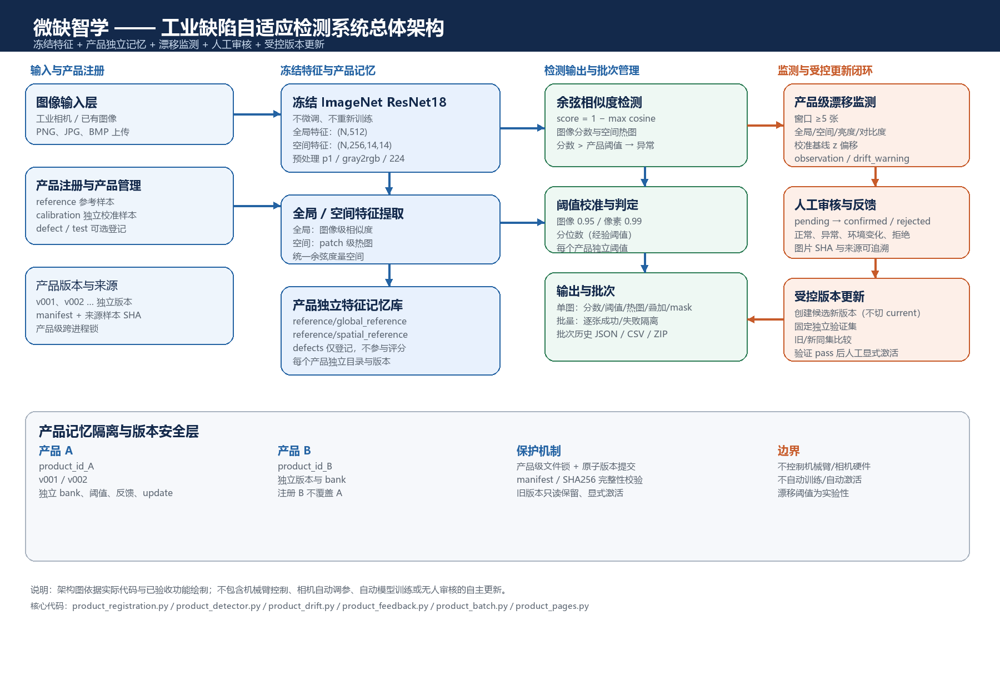

# 架构与模块

## 总体架构



系统分为四层：

1. **用户操作层**：Streamlit 页面，上传图片、选择产品、查看结果与历史。
2. **算法处理层**：冻结特征提取、余弦评分、阈值判断、漂移统计。
3. **数据存储层**：产品版本、特征记忆、批次、漂移、反馈、更新报告。
4. **反馈更新层**：人工审核、候选版本、独立验证、人工激活与旧版本保留。

## 模块与文件

| 模块 | 主要文件 | 职责 |
|---|---|---|
| 产品存储/版本 | `src/core/products.py` | 产品、版本、manifest、产品级锁、current 切换 |
| 产品注册 | `src/core/product_registration.py` | 样本校验、来源复制、特征提取、bank/阈值、版本提交 |
| 特征记忆库 | `src/core/product_bank.py` | `features.npy`、`members.csv`、`metadata.json`，成员校验 |
| 阈值校准 | `src/core/product_calibration.py` | 图像/像素经验分位阈值 |
| 单图检测 | `src/core/product_detector.py` | 加载当前版本，余弦评分，热图/mask |
| 余弦评分 | `src/anomaly/mvtec_protocol_scoring.py` | `1 - max cosine`，空间热图 |
| 批量检测 | `src/core/product_batch.py` | 逐张处理、失败隔离、批次历史 |
| 漂移监测 | `src/core/product_drift.py` | 窗口统计、校准基线 z、预警等级 |
| 反馈/更新 | `src/core/product_feedback.py` | 审核状态、候选版本、固定验证、显式激活 |
| 界面 | `src/ui/app.py`、`services.py`、`product_pages.py` | 页面、上传/下载、调用核心模块 |

## 数据流

```text
图片
  → 格式/尺寸校验
  → 冻结特征提取（全局 512 / 空间 256×14×14）
  → 与产品 reference bank 计算 1−max cosine
  → 图像分数 + 空间热图
  → 阈值判断（正常/异常）
  → 单图/批量结果、批次历史

同一批窗口
  → 全局/空间/亮度/对比度统计
  → 校准基线 z
  → normal / observation / drift_warning
  → 人工审核
  → confirmed 正常/异常
  → 候选版本
  → 固定验证集
  → pass / fail / inconclusive
  → 人工显式激活（旧版本保留）
```

## 产品数据目录

```text
products/<product_id>/
  product.json
  versions/v001/
    version.json
    manifest.json
    thresholds.json
    reference/global_reference/features.npy
    reference/spatial_reference/features.npy
    samples/...
  versions/v002/...
  feedback/
    records/
    images/
    updates/<update_id>/
      report.json
      report.sha256
      activation.json
      validation/
```

批次与漂移记录在 `cache/product_batches/`、`cache/product_drift/`；它们都是本地文件，不依赖数据库。

## 版本与激活

- 更新创建新版本，`activate=False`，不改 current；
- 验证使用固定副本，旧/新版本同集比较；
- `pass` 后仍需人工点击；
- current 切换使用比较并交换（CAS），发现并发变化拒绝；
- 旧版本保留，可加载；
- 更新报告有 SHA/完整性索引，但它是产品级记录，不是密码学签名。

## 多产品隔离

每个产品使用独立 `product_id`、版本、bank、阈值、反馈和 update 目录；产品级锁文件按产品分离。共享的是冻结特征器，产品记忆不共享。
